# Aquarium — Architecture and Implementation Plan

Living design document for Aquarium (`service_id: aquarium`), a product of the `bwinkeler.com` platform. It follows the platform contract `BW-PLATFORM-ARCH-001` v1.3 (`bwinkeler-infra/ARCHITECTURE.md`); where the two conflict, the platform contract and its precedence rules prevail, and every deviation is listed in [5. Platform conformance](#5-platform-conformance). Platform facts were verified against official documentation and source code between 2026-11-03 and 2026-11-07.

**Status:** design approved. Implemented: repository, docs and CI (Phase 1); `shared`, `engine` (Canvas 2D renderer) and `extractor` (free sheet and printed ArUco templates) from Phase 2; the Worker (Phase 3, deployed); the TV app as the `/tv/` browser build, plus the site root with clickable controls (Phase 4; the webOS package, the WebGL renderer and the background video wait for the spike); the phone PWA under `/join/` with the printable templates (Phase 5); `deploy.yaml` and the end-to-end Playwright test (Phase 6). Until a background video exists, the engine paints a layered procedural seabed.
**Last updated:** 2026-11-08.

| Field             | Value                                                        |
| ----------------- | ------------------------------------------------------------ |
| Service ID        | `aquarium`                                                   |
| Production origin | `https://aquarium.bwinkeler.com`                             |
| Repository        | `brunowinkeler/bwinkeler-aquarium` (public)                  |
| Platform contract | `BW-PLATFORM-ARCH-001` v1.3                                  |
| Requirements      | [`REQUIREMENTS.md`](REQUIREMENTS.md) (`BW-AQUARIUM-REQ-001`) |

## Contents

1. [Overview](#1-overview)
2. [Requirements](#2-requirements)
3. [Decisions](#3-decisions)
4. [Confirmed platform facts](#4-confirmed-platform-facts)
5. [Platform conformance](#5-platform-conformance)
6. [System architecture](#6-system-architecture)
7. [Aquarium lifecycle](#7-aquarium-lifecycle)
8. [Sending a drawing](#8-sending-a-drawing)
9. [appMobile (PWA)](#9-appmobile-pwa)
10. [appTV (webOS 4.x)](#10-apptv-webos-4x)
11. [Animation engine](#11-animation-engine)
12. [Backend (Cloudflare Worker)](#12-backend-cloudflare-worker)
13. [Scaling to more TVs and brands](#13-scaling-to-more-tvs-and-brands)
14. [Repository layout and operations](#14-repository-layout-and-operations)
15. [Implementation plan](#15-implementation-plan)
16. [Verification](#16-verification)
17. [Scope and rejected alternatives](#17-scope-and-rejected-alternatives)
18. [Open questions](#18-open-questions)
19. [References](#19-references)

## 1. Overview

A child draws a sea creature on paper. A phone photographs it, removes the paper, and previews the creature swimming. One tap sends it to the TV, where it joins an animated aquarium.

An aquarium is a short-lived shared session, like a game room: the TV creates it, several phones join it with a code shown on the TV, and everyone can send drawings. When its TV has been disconnected for 4 hours, the aquarium and its drawings are deleted, and the next session starts with a new aquarium.

The system has three parts:

1. **appMobile** — an installable PWA for iOS and Android. It joins an aquarium, captures or loads a photo, removes the paper on the device with classical computer vision (no AI), and shows an animated preview.
2. **backend** — one Cloudflare Worker on `aquarium.bwinkeler.com`, with Durable Objects and an R2 bucket. It serves the PWA, keeps each aquarium's state in its own Durable Object, stores the PNG images in R2, and pushes real-time events to the TV over WebSocket. It does not use the platform VPS.
3. **appTV** — a packaged webOS 4.x app (Chromium 53). It creates the aquarium, shows the join code, plays a full-screen looping underwater video, and animates the creatures on a transparent WebGL canvas.

The **same animation engine** runs in the phone preview and on the TV, so the creature the user confirms on the phone is exactly what appears on the TV. Implementation starts with risk spikes on the real TV (performance, screensaver, TLS) before building the rest.

## 2. Requirements

The prompt that started the project will be archived verbatim, untranslated, in `bwinkeler-infra/docs/archive/prompts/aquarium.md` (private repository). The normative baseline will be `docs/REQUIREMENTS.md` (`BW-AQUARIUM-REQ-001`). Summary:

**Drawing and display**

- The user draws on a sheet of white paper; the drawing may be colored or just outlined.
- A photo is taken inside appMobile, or an existing photo is loaded from the gallery.
- appMobile previews the drawing without the white background.
- The user confirms and sends the drawing to the TV.
- The TV shows the drawing exactly as previewed and animates it fluidly, like an aquatic creature, inside an aquarium scene.

**Sessions** (added on 2026-11-07)

- The TV app opens on a home screen with a "New aquarium" action.
- The TV then shows a join code; a user types it in appMobile to join the aquarium.
- The TV notices when a phone joins and keeps an option on screen to show the code again, so more people can join and collaborate.
- Joined users send drawings to the aquarium.
- An aquarium has exactly one TV; several phones can join it (decided on 2026-11-07).
- Aquariums are not kept for long: if the TV does not reconnect within a time limit, the aquarium is deleted and a new one must be created.

**Platforms**

- appMobile runs on iOS and Android; a hybrid (non-native) platform is acceptable.
- appTV targets one TV first:

| Property              | Value                           |
| --------------------- | ------------------------------- |
| Model                 | LG 43UK6300PLB                  |
| webOS TV version      | 4.4.3-22 (goldilocks-gorongosa) |
| Free internal storage | 0.14 GB of 0.53 GB              |

Other TV brands are in scope only if they require no extra development or research; the design keeps the door open for them ([13](#13-scaling-to-more-tvs-and-brands)).

## 3. Decisions

| Topic                 | Decision                                                                                                                                                                                                                          |
| --------------------- | --------------------------------------------------------------------------------------------------------------------------------------------------------------------------------------------------------------------------------- |
| Platform placement    | Product `aquarium` of `bwinkeler.com`, in its own public repository                                                                                                                                                               |
| Backend               | Cloudflare Worker + Durable Objects + R2 on the existing account, on the Custom Domain `aquarium.bwinkeler.com`; a documented exception to the platform's VPS default (ADR 001)                                                   |
| Aquarium lifecycle    | Short-lived session owned by the single TV that created it; deleted after **4 hours** without that TV connected (configurable); no maximum lifetime while the TV stays connected; "End aquarium" on the TV deletes it immediately |
| Joining               | 6-character code and QR shown on the TV, typed or scanned on the phone; a code is valid for 10 minutes and can be used by several phones; the TV can show a code again at any time                                                |
| Accounts              | None. The TV holds a bearer token and each phone a session cookie; both end with the aquarium (ADR 003)                                                                                                                           |
| Image storage         | Private R2 bucket `bwinkeler-aquarium-files`; the Durable Object keeps metadata only (platform §16)                                                                                                                               |
| Mobile platform       | PWA: no app store, no Mac, instant updates                                                                                                                                                                                        |
| Mobile UI stack       | React 19 + Vite 8 + react-router 7 + `vite-plugin-pwa` with prompted updates, as in Practice Companion                                                                                                                            |
| Paper input           | Free white sheet (automatic paper detection + manual corner adjustment) **and** a printed template with ArUco markers (automatic rotation; the creature kind is encoded in the marker IDs)                                        |
| Creature kinds        | `swim` (fish), `pulse` (jellyfish), `walk` (crab, starfish), `glide` (turtle, ray)                                                                                                                                                |
| Outline-only drawings | The enclosed white interior stays opaque (sticker look)                                                                                                                                                                           |
| Capacity              | At most 20 creatures per aquarium; the oldest swims away and is deleted                                                                                                                                                           |
| Language              | Code, docs and identifiers in English; Portuguese-first interface with typed `pt-BR` and `en` catalogues (ADR 005)                                                                                                                |
| Tooling               | npm workspaces, Node 22.14.0, TypeScript 6.0.3, Vite 8, ESLint 10, Prettier 3.9.6, Vitest 5 (required by the current Vite peer set), Playwright + axe, as in the other platform repositories                                      |
| TV renderer           | Custom lightweight WebGL 1 renderer with a Canvas 2D fallback (final choice after spike 1)                                                                                                                                        |
| TV app type           | Packaged app (IPK) behind a platform adapter; the same build is also served at `/tv/` for any modern browser                                                                                                                      |

## 4. Confirmed platform facts

Each fact below was checked against the cited source and drives a design decision. Items not yet confirmed are listed in [4.4](#44-to-verify-on-the-real-tv-phase-0).

### 4.1 LG 43UK6300PLB / webOS TV 4.x

| Fact                                                                                                                                                                                                                                                                                        | Design impact                                                                                                                           | Source                                                                                             |
| ------------------------------------------------------------------------------------------------------------------------------------------------------------------------------------------------------------------------------------------------------------------------------------------- | --------------------------------------------------------------------------------------------------------------------------------------- | -------------------------------------------------------------------------------------------------- |
| webOS TV 4.x (2018–2019) uses **Chromium 53**. User agent: `Mozilla/5.0 (Web0S; Linux/SmartTV) AppleWebKit/537.36 (KHTML, like Gecko) Chrome/53.0.2785.34 Safari/537.36 WebAppManager`                                                                                                      | Build for `chrome53` with polyfills: no native async/await, ES modules, `Object.entries` or `globalThis`                                | [LG: Web API and Web Engine][lg-engine]                                                            |
| From webOS TV 4.0, LG no longer publishes API support charts; Chrome compatibility on MDN applies, but platform-specific functions may differ                                                                                                                                               | Check MDN for Chrome 53 and confirm on the device                                                                                       | [LG: Web API and Web Engine][lg-engine]                                                            |
| Only hosted web apps (HTTP/HTTPS) can use cookies; packaged apps use the `file` scheme. The engine cache is only used while the app runs                                                                                                                                                    | The TV authenticates with a bearer token on CORS-enabled `/api/tv/*` routes (origin `null`); no reliance on HTTP cache between launches | [LG: Web API and Web Engine][lg-engine]                                                            |
| A hosted web app is a local shell that redirects to a remote page; its resources are downloaded from the server at launch                                                                                                                                                                   | Packaged app for fast, offline-capable startup                                                                                          | [LG: Web App Types][lg-app-types]                                                                  |
| `resolution`: `"1920x1080"` (default) or `"1280x720"`; UHD is not supported for web apps; read the real size from `window.innerWidth` and `window.innerHeight`                                                                                                                              | Render target 1080p or 720p, chosen in spike 1                                                                                          | [LG: appinfo.json][lg-appinfo]                                                                     |
| `disableBackHistoryAPI: true` makes the app receive the Back button event                                                                                                                                                                                                                   | Handle Back in the app                                                                                                                  | [LG: appinfo.json][lg-appinfo]                                                                     |
| `icon` is an 80×80 PNG, `largeIcon` 130×130 PNG, `splashBackground` 1920×1080 PNG. `id` uses lowercase letters, digits, `-` and `.`, cannot start with `com.palm`, `com.webos`, `com.lge` or `com.palmdts`, and should avoid `-` if JS services are added. `version` is `major.minor.patch` | IPK asset and naming conventions                                                                                                        | [LG: appinfo.json][lg-appinfo]                                                                     |
| Basic screensaver policy: it starts after a period without user action, **except while a video plays full screen**                                                                                                                                                                          | The ambient aquarium needs a playing full-screen video                                                                                  | [LG: Screensaver][lg-screensaver]                                                                  |
| Full screen means the playing area covers 100% of the viewport at position 0,0; `border`, `transform` or a fully transparent `opacity` on the video may launch the screensaver. LG's example uses 1280×720 for FHD and 1920×1080 for UHD models                                             | Background video fixed at 0,0, sized to the viewport, no transform or opacity                                                           | [LG FAQ: full-screen video][lg-fullscreen-video]                                                   |
| `screenSaverProperties` Type 2/3 (30-minute timeout) apply only to **OLED TVs with webOS TV 5.0+**                                                                                                                                                                                          | Not available on this LCD webOS 4 TV                                                                                                    | [LG: Screensaver][lg-screensaver]                                                                  |
| Developer Mode needs an LG Developer account; the session time is limited and can be extended with **EXTEND** while the TV is online, but not after it runs out                                                                                                                             | Renew proactively                                                                                                                       | [LG: Developer Mode app][lg-devmode]                                                               |
| Developer Mode is disabled on reboot once the session time has run out, or after 10 reboots without network; **apps installed in Developer Mode are then uninstalled**                                                                                                                      | Automated renewal; reinstall scripts                                                                                                    | [LG: Developer Mode app][lg-devmode]                                                               |
| Connection: `ares-setup-device` (port `9922`, user `prisoner`, no password), turn on Key Server, run `ares-novacom --device <tv> --getkey` with the 6-character passphrase shown in the app, check with `ares-device --system-info --device <tv>`                                           | Install, launch and inspect scripts                                                                                                     | [LG: Developer Mode app][lg-devmode]                                                               |
| Renewal endpoint: `https://developer.lge.com/secure/ResetDevModeSession.dev?sessionToken=<token>`. The token is stored on the TV in `/var/luna/preferences/devmode_enabled`, readable over SSH (`prisoner@<tv>`, port `9922`)                                                               | Scheduled renewal workflow with the token as a secret                                                                                   | [webosbrew dev-manager-desktop][webosbrew-dev-manager], [webosbrew dev-utils][webosbrew-dev-utils] |
| `luna://com.webos.service.tv.systemproperty` → `getSystemInfo` returns `modelName`, `firmwareVersion`, `sdkVersion`, `UHD` and `boardType` (`modelName` and `firmwareVersion` require user agreement)                                                                                       | Device info in the debug overlay                                                                                                        | [LG: TV Device Information][lg-systeminfo]                                                         |
| TV firmware libraries contain undocumented `REGISTERSCREENSAVERREQUEST` / `RESPONSESCREENSAVERREQUEST` Luna calls                                                                                                                                                                           | Not used: undocumented; the video approach is the official one                                                                          | [webosbrew dev-toolbox-cli][webosbrew-toolbox]                                                     |

### 4.2 Cloudflare

| Fact                                                                                                                                                                                                                                                                                            | Design impact                                                                                                                         | Source                                         |
| ----------------------------------------------------------------------------------------------------------------------------------------------------------------------------------------------------------------------------------------------------------------------------------------------- | ------------------------------------------------------------------------------------------------------------------------------------- | ---------------------------------------------- |
| Durable Objects are available on the Workers Free plan with the **SQLite** storage backend only                                                                                                                                                                                                 | `new_sqlite_classes` migration                                                                                                        | [Durable Objects limits][cf-do-limits]         |
| Max string, BLOB or row size: **2 MB**. Free plan: 5 GB of Durable Object storage per account and 1 GB per object. Received WebSocket messages up to 32 MiB                                                                                                                                     | The Durable Object keeps metadata only; images go to R2, as the platform requires for files                                           | [Durable Objects limits][cf-do-limits]         |
| The Hibernation WebSocket API keeps clients connected while the object is evicted; protocol ping frames get automatic pongs without waking it; `serializeAttachment` holds up to 16 KiB                                                                                                         | Idle TV connections cost nothing; browsers cannot send protocol pings, so the app-level ping uses an auto-response                    | [Durable Objects WebSockets][cf-do-websockets] |
| Hibernated WebSockets stay connected when the object adopts new code; a forced code update disconnects WebSockets on running instances                                                                                                                                                          | The TV reconnects and resyncs after a deploy                                                                                          | [Durable Objects WebSockets][cf-do-websockets] |
| Requests should be validated in the Worker before reaching a Durable Object (both are billed per request)                                                                                                                                                                                       | Auth and validation in the Worker                                                                                                     | [Durable Objects WebSockets][cf-do-websockets] |
| Workers Free: **10 ms CPU** per request, 100,000 requests per day, 128 MB memory; static assets up to 25 MiB per file and 20,000 files per version                                                                                                                                              | Uploads are checked and stored without decoding the image; Workers Paid only if the CPU limit is hit                                  | [Workers limits][cf-workers-limits]            |
| Static assets support `not_found_handling: "single-page-application"`, and `run_worker_first` accepts route patterns such as `/api/*`                                                                                                                                                           | One Worker serves the PWA, `/tv/`, `/api/*`, `/ws/*` and `/health/*` on one origin                                                    | [Static assets configuration][cf-assets]       |
| A Worker Custom Domain creates the DNS record and an Advanced Certificate for the hostname; changing its settings (such as the CA) means replacing it with a self-managed advanced certificate                                                                                                  | No manual DNS or certificate work for `aquarium.bwinkeler.com`; replacing the certificate is the fallback if the TV rejects the chain | [Custom Domains][cf-custom-domains]            |
| Rate Limiting binding: `ratelimits` config, `period` of 10 or 60 s, approximate and per Cloudflare location; strict limits need a Durable Object; requires Wrangler 4.36.0+                                                                                                                     | Soft per-IP limits plus strict counters in Durable Objects                                                                            | [Rate Limiting binding][cf-rate-limit]         |
| Edge certificates: Google Trust Services is the most compatible (cross-signed with a GlobalSign root installed for 20+ years). Let's Encrypt requires trusting the self-signed ISRG Root X1; older devices that only trust the cross-signed version stopped working after the 2024 chain change | Test TLS from the TV app in spike 2                                                                                                   | [Certificate authorities][cf-cas]              |

### 4.3 Libraries and assets

| Fact                                                                                                                                                                                                                                                                                                                                           | Design impact                                                                                                                                             | Source                          |
| ---------------------------------------------------------------------------------------------------------------------------------------------------------------------------------------------------------------------------------------------------------------------------------------------------------------------------------------------- | --------------------------------------------------------------------------------------------------------------------------------------------------------- | ------------------------------- |
| Kenney **Fish Pack**: 120 files, CC0 license                                                                                                                                                                                                                                                                                                   | Backdrop and demo art without licensing concerns                                                                                                          | [Kenney Fish Pack][kenney-fish] |
| **js-aruco2** 2.0.0: pure JavaScript ArUco port; `ARUCO` and `ARUCO_MIP_36h12` (250 codes) dictionaries built in; detects markers on `ImageData` or raw RGBA. MIT, but its license file also carries ArUco (BSD), OpenCV (BSD) and AForge.NET (LGPL-3.0) notices, and its script-style CommonJS (`this.AR = AR`) does not bundle with Rolldown | Used only in tests, as the reference for the marker codes and as an independent reader of the printed markers; the extractor ships its own small detector | [js-aruco2][js-aruco2]          |
| **PixiJS v8** defaults to WebGL 2 and treats WebGL 1 as a legacy fallback                                                                                                                                                                                                                                                                      | Rejected for Chromium 53 in favor of a small custom renderer                                                                                              | [PixiJS][pixijs]                |

### 4.4 To verify on the real TV (Phase 0)

- WebGL 1 availability and FPS with 20 deforming creatures at 1920×1080 and 1280×720.
- Looping video: seam quality, and screensaver suppression over at least 2 hours without remote input.
- TLS and WSS from the TV app to `aquarium.bwinkeler.com` (certificate chain of the Custom Domain), and CORS from `file://`.
- WebGL texture upload from PNG blobs fetched by an app running on `file://`.
- IndexedDB Blob support and storage quota.
- Remote key codes: Back `461`, OK `13`, Red `403`.
- Eco auto power-off on this EU model, and whether it must be disabled in the settings.
- Memory stability over an 8-hour run.

## 5. Platform conformance

Each row maps a rule of the platform contract to this product. Deviations are deliberate and recorded in ADRs, as the contract's precedence rule (§1.4) requires.

| Platform rule                            | Aquarium                                                                                                                                                             | Status                                                                        |
| ---------------------------------------- | -------------------------------------------------------------------------------------------------------------------------------------------------------------------- | ----------------------------------------------------------------------------- |
| §3.1 One subdomain per application       | `aquarium.bwinkeler.com`, a Worker Custom Domain                                                                                                                     | Conforms                                                                      |
| §4.3 Repository and documentation layout | `docs/` with `PLATFORM_ARCHITECTURE.md` (copy), `REQUIREMENTS.md`, `SERVICE_MANIFEST.md`, `OPERATIONS.md`, `DESIGN.md` and ADRs; `AGENTS.md`                         | Conforms                                                                      |
| §5 Naming                                | `service_id` `aquarium`; Worker `bwinkeler-aquarium`, R2 bucket `bwinkeler-aquarium-files`                                                                           | Conforms                                                                      |
| §6.1 Self-contained local development    | `wrangler dev` runs the Worker, Durable Objects and R2 locally; no Compose file                                                                                      | Conforms (different tooling)                                                  |
| §9.4 Same origin per application         | PWA, `/api` and `/ws` share one host                                                                                                                                 | Conforms; the TV runs on `file://`, so only `/api/tv/*` allows CORS (ADR 002) |
| §11 PostgreSQL and migrations            | SQLite inside each aquarium's Durable Object; forward-only migrations embedded in the code                                                                           | **Exception** (ADR 001)                                                       |
| §12.4 WebSocket contract                 | Defined in [12.2](#122-websocket-contract)                                                                                                                           | Conforms                                                                      |
| §13.3 No secrets in client bundles       | Nothing secret in the PWA or the TV app                                                                                                                              | Conforms                                                                      |
| §14.1 Health checks                      | `/health/live` and `/health/ready` in the Worker                                                                                                                     | Conforms                                                                      |
| §14.2 Sessions                           | Phone: `Secure`/`HttpOnly`/`SameSite=Lax` cookie persisted in the Durable Object; TV: opaque bearer token; both revocable and bounded by the aquarium's life         | Conforms (ADR 003)                                                            |
| §15 Authentication and family access     | No accounts: anonymous, short-lived aquariums created from the TV; joining requires the code shown on the TV; abuse limits in [12.5](#125-security-and-abuse-limits) | **Exception** (ADR 003)                                                       |
| §16 Files and object storage             | Own private bucket through a binding (no credentials), authorized proxy, unpredictable object names, deleted with the aquarium                                       | Conforms                                                                      |
| §18 Docker images and CI                 | `wrangler deploy` with Worker versions; rollback with `wrangler rollback`                                                                                            | **Exception** (ADR 001)                                                       |
| §20 Backups                              | Not applicable: aquarium data is short-lived by design and deleted on expiry                                                                                         | **Exception** (ADR 001)                                                       |
| §22.2 Logs                               | Workers Logs in JSON; tokens, cookies and join codes are never logged                                                                                                | Conforms                                                                      |

Planned ADRs, numbered like the other repositories:

| ADR | Decision                                                                                                                                |
| --- | --------------------------------------------------------------------------------------------------------------------------------------- |
| 001 | Cloudflare Workers + Durable Objects + R2 instead of the VPS stack, with short-lived data and no backups                                |
| 002 | webOS 4 TV client: Chromium 53 baseline, packaged app, CORS on `/api/tv/*`, background video, Developer Mode renewal, platform adapters |
| 003 | Anonymous short-lived aquariums: creation from the TV, join codes, cookie and token sessions, abuse limits                              |
| 004 | On-device drawing extraction with classical computer vision and printed ArUco templates                                                 |
| 005 | Portuguese-first bilingual interface (same pattern as KeyPlay and Practice Companion)                                                   |

The platform contract itself does not change. If a second application adopts Workers, propose a v1.4 that lists it as an allowed backend.

## 6. System architecture

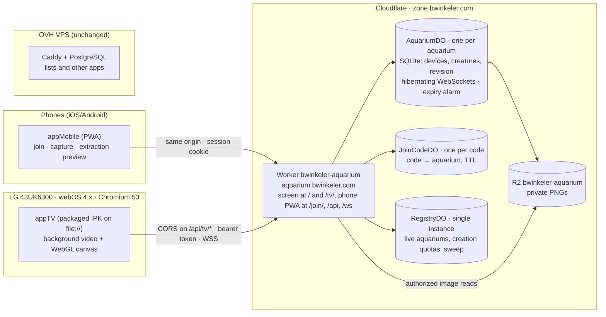

**Why this shape**

- A web app on the TV cannot accept incoming connections from the phone, so a relay is needed.
- A relay in the cloud lets phones join from anywhere, not only from the home network.
- Hibernating Durable Object WebSockets keep the TV connected at no cost while idle.
- One Durable Object per aquarium isolates aquariums from each other and lets the system grow by adding aquariums, not by scaling a server.
- Serving the PWA from the same origin as the API keeps cookies simple for phones and limits CORS to the TV routes.

## 7. Aquarium lifecycle

### 7.1 States

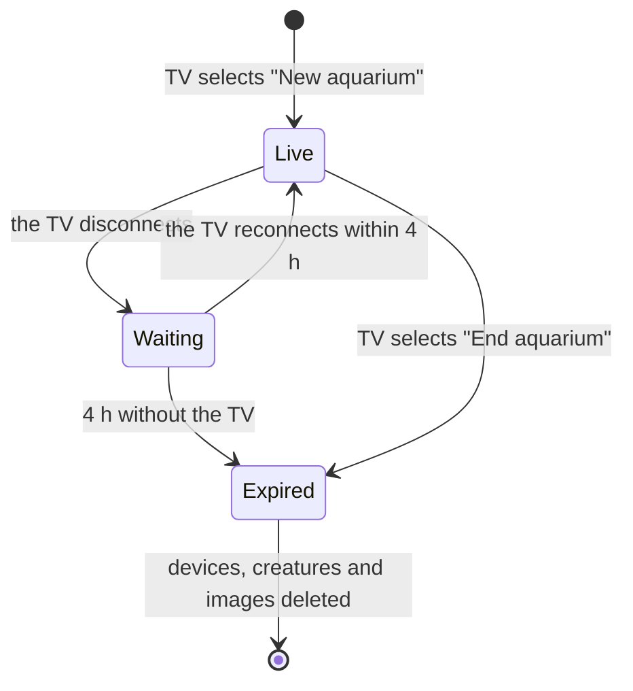

- Each aquarium has exactly one TV, the one that created it; several phones can join it.
- Only the TV's presence keeps an aquarium alive. Phones can still send drawings while it is `Waiting`; the TV receives them in the snapshot when it reconnects.
- While the TV stays connected there is no maximum lifetime.
- Expiry deletes the Durable Object's storage and the aquarium's R2 objects. Phones and TVs that still hold credentials get `410 Gone` and return to their start screens.
- Creating a new aquarium on a TV ends the one that TV was showing, so each TV has at most one live aquarium.
- The window is a configuration value (`RECONNECT_WINDOW_HOURS`, default 4).

### 7.2 TV flow

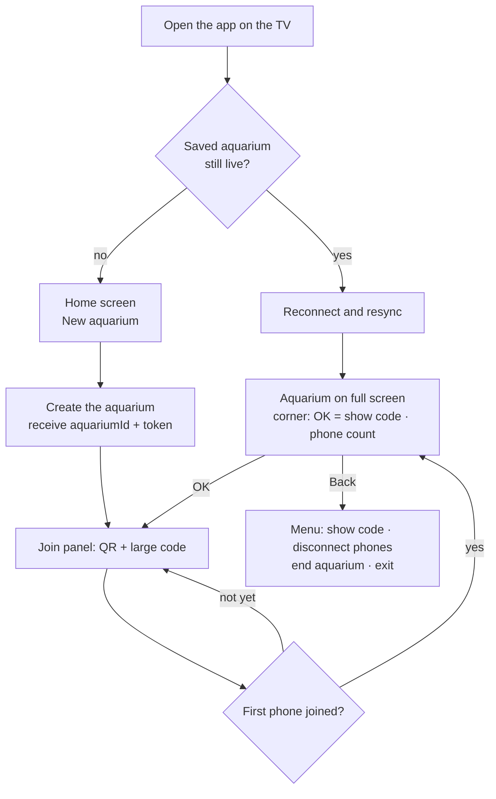

### 7.3 Creating and joining

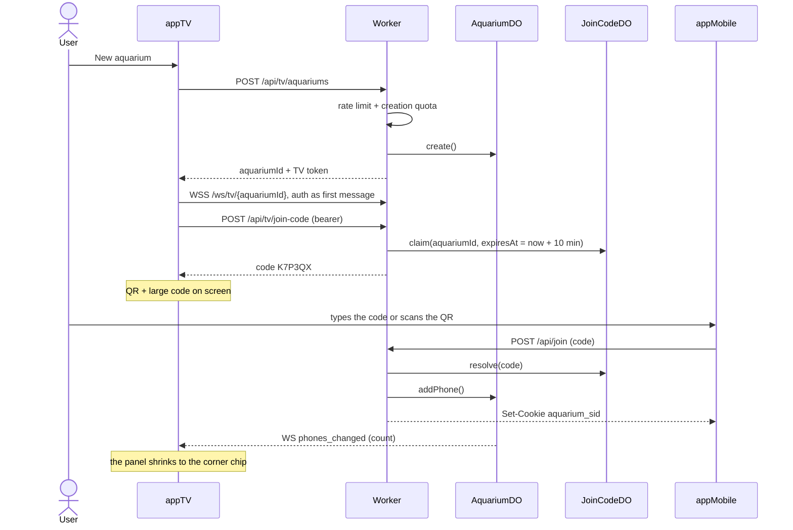

- Join code: 6 characters from Crockford Base32 (input also accepts `O` for `0` and `I` or `L` for `1`), valid for 10 minutes and usable by several phones. While the join panel is visible, the TV asks for a fresh code before the current one expires.
- Guessing is limited per IP; with about a billion possible codes and at most 50 live aquariums, a random hit is negligible, and the TV always shows how many phones joined.
- `JoinCodeDO` is addressed per code with `getByName(code)`, so there is no global bottleneck; an alarm deletes it after expiry.
- The QR code opens `https://aquarium.bwinkeler.com/join/?code=…`, which pre-fills the code; the TV also tells phones to open `aquarium.bwinkeler.com/join`.
- On iOS, a PWA installed on the home screen keeps its own storage, separate from Safari, so joining is also available inside the installed app (type the code or scan the QR).
- The TV shows a toast when a phone joins and keeps the phone count in the corner chip.
- A phone stays in the aquarium until it leaves, the TV disconnects all phones, or the aquarium ends.

## 8. Sending a drawing

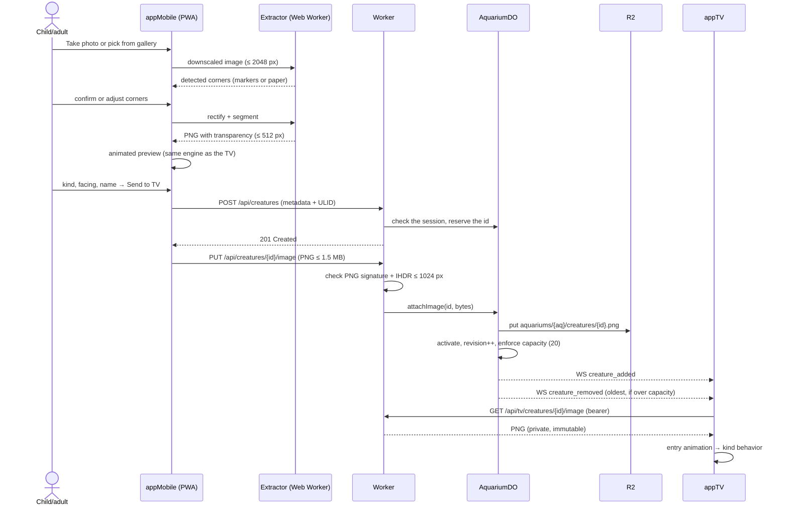

- The ULID generated on the phone is the idempotency key: retrying a request never creates a second creature.
- The Worker never decodes the image; it checks the PNG header and stores the bytes, which keeps each request far below the 10 ms CPU limit.
- The phone polls `GET /api/creatures/{id}` until `displayedAt` is set, to confirm "shown on the TV".

## 9. appMobile (PWA)

### 9.1 Screens

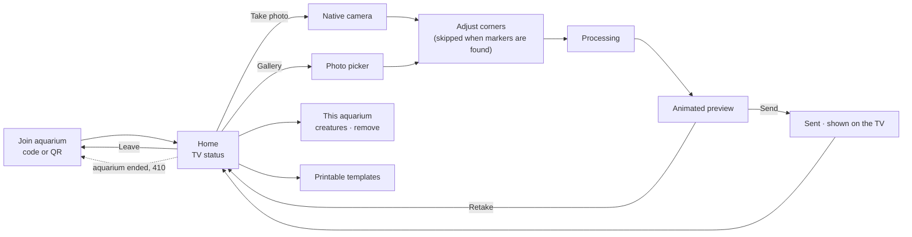

### 9.2 Preview screen (wireframe)

UI strings are shown in English here; the app opens in `pt-BR` by default (ADR 005).

```text
┌─────────────────────────────────┐
│ ←  Preview                 [PT] │
│ ┌─────────────────────────────┐ │
│ │ ~ ~ ~  aquarium backdrop ~ ~│ │
│ │        ><(((°>              │ │
│ │   your drawing swimming     │ │
│ │ ~~~~~~~~~ sand ~~~~~~~~~~~~ │ │
│ └─────────────────────────────┘ │
│ Kind: (Fish) (Jellyfish)        │
│       (Bottom) (Glider)         │
│ [⇄ Flip]  [⟳ Rotate 90°]        │
│ ▸ Adjustments                   │
│   Sensitivity      ───●──────   │
│   Close outlines   ──●───────   │
│   [ ] Include loose parts       │
│ Name (optional): [__________]   │
│ [  Retake  ]  [  Send to TV  ]  │
└─────────────────────────────────┘
```

### 9.3 Drawing extraction pipeline

Runs in a Web Worker on the phone; no AI.

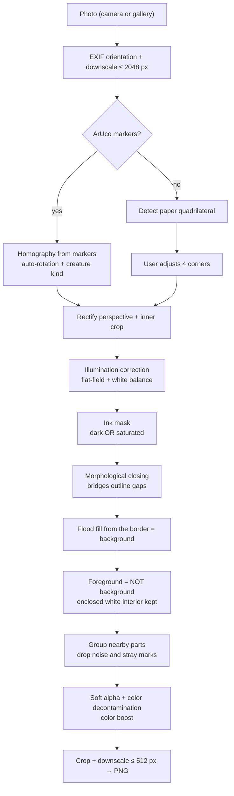

**What happens to the image at each stage**

```text
1. Rectified photo      2. Ink mask             3. Border flood fill    4. Result (PNG)
┌──────────────────┐    ┌──────────────────┐    ┌──────────────────┐    ┌──────────────────┐
│                  │    │                  │    │▒▒▒▒▒▒▒▒▒▒▒▒▒▒▒▒▒▒│    │                  │
│    /‾‾‾‾‾\  /|   │    │    /‾‾‾‾‾\  /|   │    │▒▒▒▒/‾‾‾‾‾\▒▒/|▒▒▒│    │    /‾‾‾‾‾\  /|   │
│   <  o    >< |   │ ─► │   <  o    >< |   │ ─► │▒▒▒<  o    >< |▒▒▒│ ─► │   <··o····><·|   │
│    \_____/  \|   │    │    \_____/  \|   │    │▒▒▒▒\_____/▒▒\|▒▒▒│    │    \_____/  \|   │
│  ░░ shadow       │    │                  │    │▒▒▒▒▒▒▒▒▒▒▒▒▒▒▒▒▒▒│    │                  │
└──────────────────┘    └──────────────────┘    └──────────────────┘    └──────────────────┘
 paper + shadow          strokes and colors      ▒ = reachable bg        · = interior kept
```

**Key formulas**

- Illumination correction: $I_n = I / B$, where $B$ is the paper illumination estimated by dilation and blur on a downscaled image. Dividing by the paper also white-balances the photo.
- Ink score: $s = \max(1 - L_n,\ k\,C_n)$, with $L_n$ the normalized luminance and $C_n$ the chroma. The threshold starts at Otsu's value and is tuned with the "Sensitivity" slider.
- Edge color decontamination against the white paper $W$:

$$F = \frac{C - (1-\alpha)\,W}{\alpha}$$

**Adjustments shown in the preview**

| Parameter           | Default                                           | Effect                                                                                                              |
| ------------------- | ------------------------------------------------- | ------------------------------------------------------------------------------------------------------------------- |
| Sensitivity         | Otsu threshold                                    | Lower picks up light pencil; higher ignores paper texture                                                           |
| Close outlines      | About 0.6% of the long side                       | Bridges gaps so the interior gets filled                                                                            |
| Include loose parts | Off                                               | Keeps parts far from the main body; otherwise only the main group (parts within about 2% of the image size) is kept |
| Kind, flip, rotate  | From the template; otherwise `swim`, facing right | Motion profile and head direction                                                                                   |
| Size                | Medium                                            | Small (the size before v0.4), medium (1.35×) or large (1.75×) on the TV; the preview compresses the range           |

### 9.4 Printable template

```text
┌──────────────────────────────────────────────────────┐
│ ▣ 0   Aquarium                                  1 ▣  │
│ ┌──────────────────────────────────────────────────┐ │
│ │                                                  │ │
│ │                    Draw here                     │ │
│ │                                                  │ │
│ └──────────────────────────────────────────────────┘ │
│ ▣ 3   Template: fish                            2 ▣  │
└──────────────────────────────────────────────────────┘
```

- A4 landscape; one 28 mm `ARUCO_MIP_36h12` marker per corner, 10 mm from the edges; the frame
  spans the width between the marker rows (277 × 126 mm).
- Each corner has its own ID, so the photo's orientation is known; 3 of the 4 markers are enough.
  The extractor finds dark square blobs (local threshold), reads their 6×6 bits in the four
  rotations (at most 3 wrong bits), fits a least-squares homography from template millimetres to
  the photo through every marker corner and rejects it when a corner is off by more than 12% of a
  marker side.
- The crop stays 2 mm inside the frame line (plus the usual inset), so the line never reaches the
  mask; the corner step is skipped and the kind preselected.
- `scripts/generate-templates.mjs` (`npm run templates`) writes an SVG preview and an A4 PDF per
  kind and language (pt-BR, en) into `frontend/public/templates/` from the layout in
  `extractor/src/template.ts`; CI checks that they are reproducible. The "Printable templates"
  screen (`/templates`, no session needed) offers them.
- Marker ID sets encode the creature kind:

| Marker IDs | Kind                            |
| ---------- | ------------------------------- |
| 0–3        | Generic (chosen in the preview) |
| 4–7        | `swim`                          |
| 8–11       | `pulse`                         |
| 12–15      | `walk`                          |
| 16–19      | `glide`                         |

### 9.5 Platform notes

- Camera: `<input type="file" accept="image/*" capture="environment">` opens the native camera; the same input without `capture` opens the gallery.
- Decode and downscale on the main thread, then transfer the RGBA buffer to the Web Worker, which avoids depending on `OffscreenCanvas` support in workers.
- Output PNG through `canvas.toBlob('image/png')`; WebP encoding is not available in every mobile browser.
- The preview plays the same background video as the TV (720p copy) and uses the same engine, seeded with the creature ID.
- A service worker scoped to `/join/` caches the app shell, the background video and the templates; capture and preview work offline, sending needs the network.
- Photo as it is: at the corner step the phone can pick "a photo" instead of "a drawing". The corners then frame the whole photo, and `extractPhoto` only straightens and crops it (warp at twice the output size, then area-average down to at most 512 px), so the opaque picture swims like a drawing.
- Session: joining sets the `aquarium_sid` cookie (`Secure`, `HttpOnly`, `SameSite=Lax`). State-changing requests also send a custom header, and the Worker checks that `Origin` is `https://aquarium.bwinkeler.com`; together they block cross-site requests.
- `site/_headers`, adapted from Practice Companion: `camera=(self)` in `Permissions-Policy` (QR scanning), `media-src 'self'` for the background video, `img-src 'self' data: blob:` for previews, `connect-src 'self'`, and `no-cache` for the service workers and the manifest.
- Addresses: the aquarium screen is the site root (clickable controls) and `/tv/` (remote control); the phone app lives under `/join/`, and `site/_redirects` serves its single page for `/join/new`, `/join/creatures` and `/join/templates`. `/pc/` and the old phone paths (`/new`, `/creatures`, `/templates`) redirect to their new places. Phones and installed copies that still open the root are sent to `/join/`, and `/sw.js` replaces the old root service worker with one that unregisters itself; the manifest keeps the `id` `/`, so installed copies stay the same app.
- Install: on iOS, Share → Add to Home Screen; on Android, the install prompt.

## 10. appTV (webOS 4.x)

### 10.1 Constraints and mitigations

| Constraint                               | Impact                                                                          | Mitigation                                                                                                                        |
| ---------------------------------------- | ------------------------------------------------------------------------------- | --------------------------------------------------------------------------------------------------------------------------------- |
| Chromium 53                              | No native async/await, no ES modules, missing APIs                              | esbuild target `chrome53`, single IIFE bundle, explicit polyfills, `es-check` in CI                                               |
| Packaged app runs on `file://`           | No cookies, origin `null`, the `crossorigin` attribute can break script loading | Bearer token, CORS only on `/api/tv/*`, `base: './'`, strip `crossorigin`                                                         |
| Screensaver without remote input         | The aquarium goes dark                                                          | Playing full-screen video (documented exception)                                                                                  |
| Developer Mode expiry                    | LG uninstalls the app                                                           | Daily automated renewal and install scripts                                                                                       |
| Modest CPU/GPU                           | Low FPS                                                                         | Light WebGL 1 meshes, textures ≤ 512 px, optional 720p rendering, adaptive quality, hardware-decoded background                   |
| 0.14 GB free storage                     | IPK size                                                                        | IPK of about 25 MB at most (video ≤ 20 MB)                                                                                        |
| Older root certificates                  | HTTPS/WSS may fail                                                              | Test from the spike app; if needed, replace the Custom Domain certificate with an advanced certificate from Google Trust Services |
| Eco auto power-off (EU model, to verify) | The TV switches off after hours without input                                   | Disable it in Settings → General → Eco (manual)                                                                                   |

### 10.2 Render layers

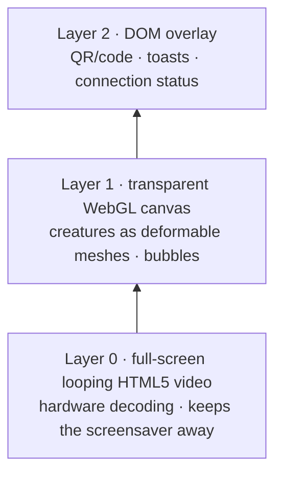

### 10.3 TV screens (wireframes)

Home screen, shown when there is no live aquarium:

```text
┌──────────────────────────────────────────────────────────────────┐
│                                                                  │
│                           ~ Aquarium ~                           │
│                                                                  │
│                   ┌────────────────────────┐                     │
│                   │ >  New aquarium        │                     │
│                   └────────────────────────┘                     │
│                                                                  │
│        Draw a sea creature, photograph it with your phone,       │
│                     and watch it swim here.                      │
│                                                                  │
└──────────────────────────────────────────────────────────────────┘
```

Right after creation, with the join panel open. Once the first phone joins, the panel shrinks to the chip at the bottom right, and OK shows it again:

```text
┌──────────────────────────────────────────────────────────────────┐
│   \   \    light rays    \                      o   bubbles      │
│        ><(((°>                          <°)))><    o             │
│                     (child's fish drawing)    o                  │
│     .-.                                                          │
│    (   )  jellyfish          ┌──────────────────────────────┐    │
│     )))                      │  Join this aquarium!         │    │
│                              │  ██▀▀██   1. Open the app    │    │
│          turtle ~>           │  ██▄▄██   2. Code K7P-3QX    │    │
│                              └──────────────────────────────┘    │
│ ~~~~~~~ sand ~~~~~~~ crab ~~~~~~~~~~~~~~~~~~~~~~~~~~~~~~~~~~~~~~ │
│  "New fish from Ana!"                   OK: show code · 2 phones │
└──────────────────────────────────────────────────────────────────┘
```

### 10.4 Build and runtime

- **Build:** Vite with esbuild target `chrome53` and one IIFE bundle (no ES modules or SystemJS at runtime), an explicit polyfill entry (selected core-js modules), `base: './'`, and `crossorigin` attributes stripped. CI runs `es-check es6` on the output. Fallback: `@vitejs/plugin-legacy`.
- **`appinfo.json`:** `id` `com.bwinkeler.aquarium` (lowercase, no `-`), `resolution` from spike 1, `disableBackHistoryAPI: true`, 80×80 `icon`, 130×130 `largeIcon`, 1920×1080 `splashBackground`.
- **Platform adapter:** remote keys, Back and exit, the keep-awake video, persistent storage and packaging sit behind `TvPlatform` ([13.3](#133-other-tv-brands-and-systems)); the rest of the app never calls webOS directly.
- **Keys:** OK (`13`) shows the join code; Back (`461`) closes an open panel or opens the menu (show code, sound, quality, FPS counter, disconnect phones, end aquarium, exit with `webOS.platformBack()`); Red (`403`) toggles the debug overlay.
- **Session:** the `aquariumId` and the TV token are kept in `localStorage`. On launch the app tries to resume; a `410` clears them and shows the home screen.
- **Lifecycle:** rendering pauses on `visibilitychange` and resyncs on resume.
- **RelayClient:** WebSocket `/ws/tv/{aquariumId}` with `auth` as the first message, exponential backoff and jitter, app-level ping every 30 s, full snapshot resync after reconnecting, revision-gap detection, polling fallback, discreet offline indicator.
- **Images:** fetched with XHR (`Authorization` header) from `/api/tv/creatures/{id}/image` as a Blob, decoded with `createImageBitmap` or an object URL, and uploaded as a WebGL texture.
- **Offline start:** creature metadata and PNGs are cached in IndexedDB and cleared when the aquarium ends.
- **Empty aquarium:** six hand-drawn demo creatures swim until drawings arrive, and the first three always stay, so a single drawing still looks like the sea; the join panel stays open until the first phone joins.
- **Seabed:** three layers painted once per size at the canvas pixel ratio. The backdrop holds the water, two hazy reef silhouettes, far kelp and corals, and sand with dunes, ripples and pebbles under a vignette; the decor layer holds the corals, rocks, shells and starfish with soft shadows; the foreground (a dark kelp, a rock and a red coral at the edges) is drawn over the creatures. Kelp, sea grass and sea lettuce are painted once into sprites and sway in 8 to 20 horizontal slices, each shifted more toward the tip, behind and in front of the corals. Sizes follow the height of a 16:9 frame, so the 4:3 phone preview is not crowded.
- **Quality and FPS:** "Quality: light (720p)" in the menu draws the scene at most 720 lines high (the renderer's pixel ratio becomes 720 / height) and lets the browser stretch the canvas; "FPS counter" shows the frame rate and the canvas size in a corner. Both choices are remembered.
- **Idle:** after 4 seconds without input the phone count fades out, together with the toolbar and cursor of the site root; any key, mouse move or touch, or a phone joining or leaving, brings them back.
- **Sound:** a generated ambience (Web Audio: slow pad chords, sparse bells, filtered-noise waves and bubbles, a feedback delay instead of reverb) plays while the aquarium is live; nothing is recorded, so nothing needs a license. Browsers keep it suspended until the first click or key press. "Sound" in the menu, and in the toolbar of the site root, turns it off and is remembered.
- **Browser build:** the same bundle at `/tv/` runs in other TVs' browsers, on a PC over HDMI, or on a Raspberry Pi in kiosk mode. The site root serves it with `data-input="pointer"`: buttons at the top right (show code, sound, full screen, menu) replace the OK and Back hints, and the join panel gets a close button.

### 10.5 Background video asset

| Property   | Value                                                                           |
| ---------- | ------------------------------------------------------------------------------- |
| Codec      | H.264 (MP4)                                                                     |
| Resolution | 1920×1080 for the TV (1280×720 if spike 1 says so); 1280×720 copy for the PWA   |
| Frame rate | 30 fps                                                                          |
| Length     | 30–60 s seamless loop                                                           |
| Size       | ≤ 20 MB for the TV, ≤ 6 MB for the PWA                                          |
| Content    | Sand, rocks, plants, light rays and bubbles; no fish, so the drawings stand out |

If looping stutters, the fallback is a static backdrop drawn in WebGL with a small full-screen video kept playing underneath only to keep the screensaver away.

## 11. Animation engine

`engine/` runs unchanged in the phone preview and on the TV.

### 11.1 Motion profiles

| Kind    | Examples           | Screen band  | Locomotion                                                       | Mesh deformation                              | Turns        |
| ------- | ------------------ | ------------ | ---------------------------------------------------------------- | --------------------------------------------- | ------------ |
| `swim`  | Fish, shark        | 10–80%       | Wanders, avoids walls and neighbors, occasional darts            | Traveling wave that grows from head to tail   | Yes (mirror) |
| `pulse` | Jellyfish, octopus | 5–60%        | Upward thrust on each contraction, slow sinking drift in between | Bell contracts; tentacles ripple with a delay | No           |
| `walk`  | Crab, starfish     | Sand, 82–95% | Walks sideways with pauses; depth follows screen height          | Step bounce and slight tilt                   | Optional     |
| `glide` | Turtle, ray        | 15–70%       | Long, slow arcs                                                  | Long low-frequency wave with gentle bobbing   | Yes          |

### 11.2 Formulas

Body wave, where $u = 0$ is the head, $u = 1$ the tail, and $f$ grows with speed:

$$\Delta y(u,t) = A_0\,u^2 \sin\!\big(2\pi(f\,t - u/\lambda)\big)$$

Steering (wander, wall avoidance, separation):

$$\vec a = w_w\,\vec a_{\text{wander}} + w_b\,\vec a_{\text{walls}} + w_s\,\vec a_{\text{sep}},\qquad \vec v \leftarrow \operatorname{clamp}(\vec v + \vec a\,\Delta t,\ v_{max})$$

- **Jellyfish pulse:** $p(t) = \max(0, \sin 2\pi f t)^3$; bell scale $s_x = 1 - c\,p$ and $s_y = 1 + c'\,p$; upward thrust proportional to $p$.
- **Walking:** $\Delta y = -h\,|\sin(\pi f t)|$.
- **Depth:** farther creatures are smaller and bluer: scale $= \operatorname{lerp}(0.65, 1, z)$, fog $= 0.35\,(1 - z)$.
- **Turning:** the sprite's horizontal scale animates from $1$ to $-1$, which reads as a 3D turn.
- **Personality:** speed, rhythm and preferred band come from a random generator seeded with the creature ID (generated on the phone), so the creature behaves the same in the preview and on the TV.

### 11.3 States

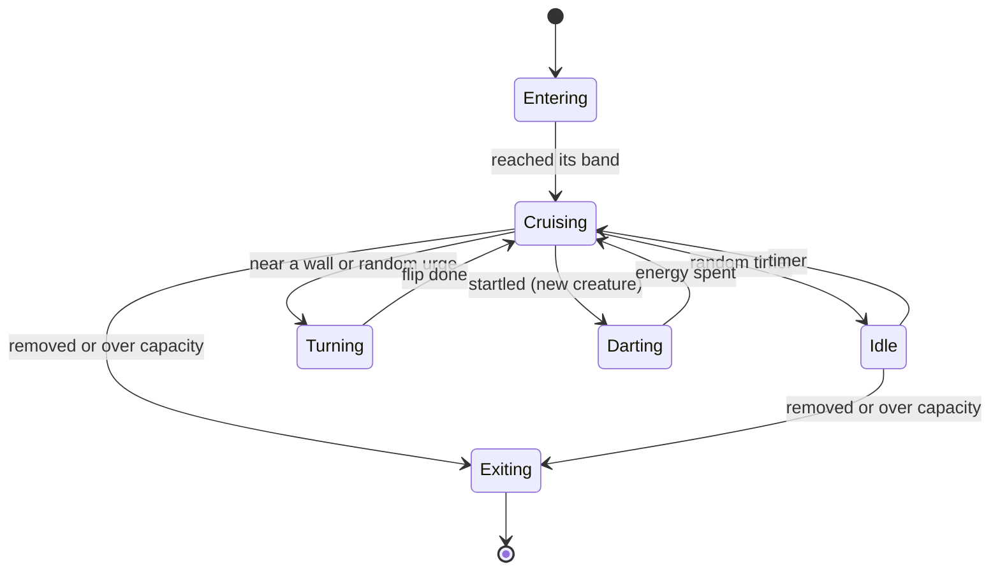

### 11.4 Rendering and performance

- One WebGL 1 grid mesh per creature (about 16×4 cells); the vertex shader applies the deformation for the creature's kind.
- Textures up to 512 px, premultiplied alpha, no mipmaps; draw order sorted by depth.
- Fixed 60 Hz simulation step with a clamped frame delta; no per-frame allocations.
- Adaptive quality: if FPS stays below 50, drop the internal resolution to 1280×720, disable caustics and reduce mesh density. Until then, the menu offers the 720p rendering by hand.
- The Canvas 2D fallback approximates the wave by drawing vertical slices of the sprite.

## 12. Backend (Cloudflare Worker)

### 12.1 HTTP and WebSocket API

TV routes (CORS `*`, no cookies):

| Method   | Route                         | Auth                          | Purpose                                                                                                                                        |
| -------- | ----------------------------- | ----------------------------- | ---------------------------------------------------------------------------------------------------------------------------------------------- |
| POST     | `/api/tv/aquariums`           | None; rate limited and capped | Create an aquarium; returns `aquariumId` and the TV token. When the TV sends its previous token as `Authorization: Bearer`, that aquarium ends |
| POST     | `/api/tv/join-code`           | TV                            | Issue a join code valid for 10 minutes                                                                                                         |
| DELETE   | `/api/tv/phones`              | TV                            | Disconnect every phone                                                                                                                         |
| DELETE   | `/api/tv/aquarium`            | TV                            | End the aquarium and delete its data now                                                                                                       |
| GET      | `/api/tv/creatures/:id/image` | TV                            | PNG                                                                                                                                            |
| GET (WS) | `/ws/tv/:aquariumId`          | `auth` message                | Real-time events                                                                                                                               |

Phone routes (same origin, session cookie):

| Method | Route                      | Auth                      | Purpose                                                                       |
| ------ | -------------------------- | ------------------------- | ----------------------------------------------------------------------------- |
| POST   | `/api/join`                | None; rate limited per IP | Exchange a join code for the session cookie                                   |
| GET    | `/api/session`             | Phone                     | TV online flag, creature count, capacity, `Waiting` deadline                  |
| POST   | `/api/leave`               | Phone                     | Leave the aquarium                                                            |
| GET    | `/api/creatures`           | Phone                     | Creature metadata                                                             |
| POST   | `/api/creatures`           | Phone                     | Reserve a creature (metadata + ULID)                                          |
| PUT    | `/api/creatures/:id/image` | Phone                     | Upload the PNG                                                                |
| GET    | `/api/creatures/:id`       | Phone                     | One creature, including `displayedAt`                                         |
| GET    | `/api/creatures/:id/image` | Phone                     | PNG                                                                           |
| DELETE | `/api/creatures/:id`       | Phone                     | Remove a creature (any phone of the aquarium; the room is the trust boundary) |

Health checks: `GET /health/live` and `GET /health/ready` (the second checks R2 and one Durable Object with a short timeout).

WebSocket messages:

| Direction   | Message            | Payload                                                                                                      |
| ----------- | ------------------ | ------------------------------------------------------------------------------------------------------------ |
| TV → server | `auth`             | TV token; must arrive within 5 s                                                                             |
| Server → TV | `snapshot`         | `revision`, all creatures, phone count                                                                       |
| Server → TV | `creature_added`   | `revision`, creature metadata                                                                                |
| Server → TV | `creature_removed` | `revision`, `id` and `reason` (`capacity` or `deleted`)                                                      |
| Server → TV | `phones_changed`   | `revision`, phone count                                                                                      |
| Server → TV | `aquarium_ended`   | `reason` (`ended` or `expired`); sent before the socket closes with code 4010                                |
| TV → server | `ping`             | The exact string `{"type":"ping"}`, answered with `{"type":"pong"}` by the runtime without waking the object |
| TV → server | `sync`             | Asks for a new `snapshot`, after a revision gap                                                              |
| TV → server | `displayed`        | Creature `id`; sets `displayedAt` so the phone can confirm                                                   |

Close codes: 4000 authentication timeout, 4001 replaced by a newer TV connection, 4003 unauthorized, 4010 aquarium ended (also sent right after the upgrade when the aquarium no longer exists, because browsers hide a refused upgrade's status), 1008 invalid message, 1009 message over 1 KB.

### 12.2 WebSocket contract

Every item that platform §12.4 requires:

| Item                      | Definition                                                                                                          |
| ------------------------- | ------------------------------------------------------------------------------------------------------------------- |
| Endpoint                  | `/ws/tv/{aquariumId}`; one socket per aquarium, and a newer authenticated socket replaces the previous one          |
| Authentication            | `auth` with the TV token as the first message within 5 s, otherwise the socket closes; no secret in the URL or logs |
| Expiration and renewal    | The token lives as long as the aquarium; ending or expiry revokes it, and a new aquarium issues a new one           |
| Heartbeat                 | App-level `ping` every 30 s                                                                                         |
| Message limit             | 1 KB from the TV; the server sends metadata only                                                                    |
| Reconnection              | Exponential backoff from 1 s to 30 s with jitter                                                                    |
| Full resynchronization    | `snapshot` on every connection                                                                                      |
| Event IDs                 | Per-aquarium `revision` counter; a gap makes the TV send `sync` for a new snapshot                                  |
| During a deploy           | Hibernated sockets stay connected; any socket that drops reconnects                                                 |
| Per-message authorization | Every message checks that the device is still valid; revoking or ending closes the socket                           |
| Idempotency               | Creature IDs are ULIDs generated on the phone                                                                       |

### 12.3 Data model

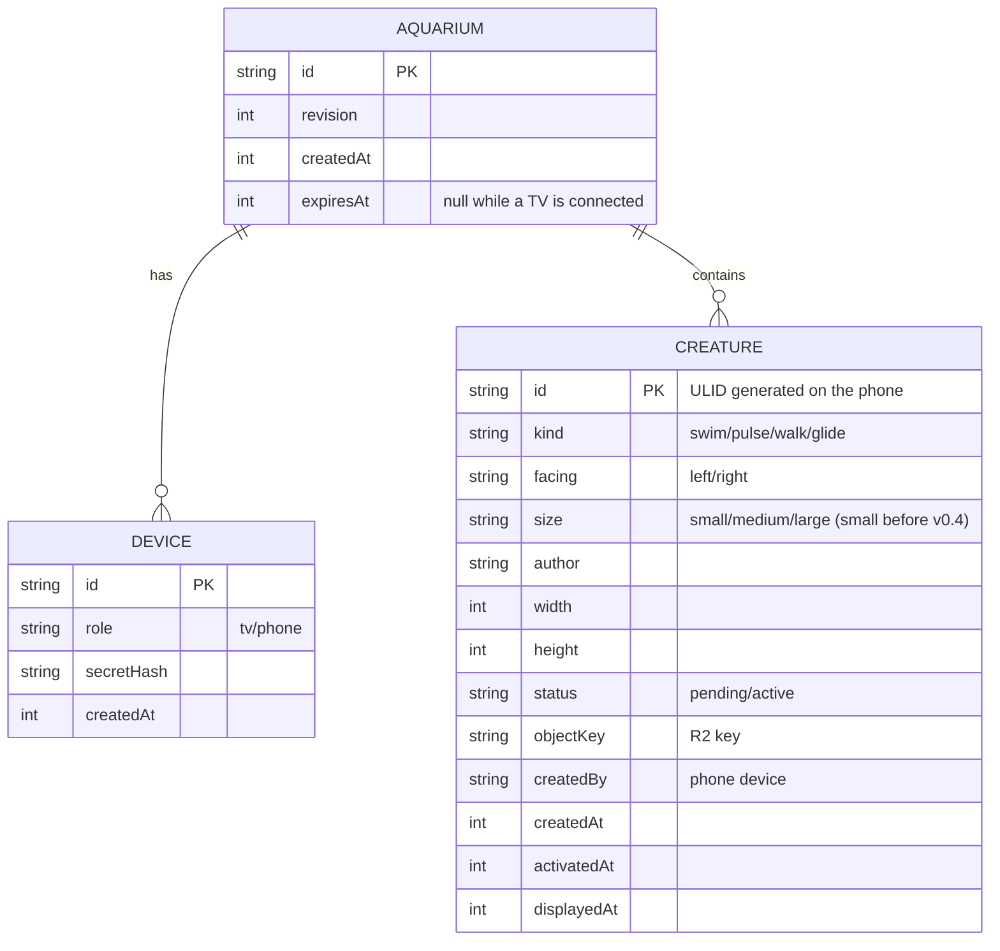

- `AQUARIUM` is the Durable Object itself (its `meta` table). Storage without the `meta` table means "no such aquarium": only `create()` writes the schema, so the object never recreates itself on access and answers `410 Gone`.
- Phones and the TV have no names. A reserved creature stays `pending` until its PNG arrives; pending reservations older than one hour are dropped, and an `upload_log` table enforces the hourly upload limit.
- Images are checked by their PNG signature and `IHDR` only, and must match the reserved width and height; the R2 `httpEtag` is the image `ETag`.
- `JoinCodeDO` stores only the `aquariumId` and the expiry.
- `RegistryDO` is a single instance, touched only on creation, expiry and the daily sweep. It stores the live aquarium IDs and per-IP creation counters (hashed IPs).
- R2 object keys: `aquariums/{aquariumId}/creatures/{creatureId}.png`.

### 12.4 Expiry and cleanup

1. When the TV socket closes, the aquarium becomes `Waiting`: `expiresAt = now + 4 h`, and the alarm is set. Creation sets the same deadline, which the TV's first authentication clears, so an aquarium whose TV never connects also expires.
2. The TV authenticating before `expiresAt` clears the deadline.
3. The alarm expires the aquarium if the TV is not connected: it closes the sockets, removes the aquarium from `RegistryDO`, deletes the R2 objects under `aquariums/{aquariumId}/`, and calls `deleteAll()`. Unregistering first means an interrupted cleanup leaves only orphaned objects, which the daily sweep removes; a failed step throws, and the alarm retries.
4. "End aquarium" on the TV runs the same steps immediately.
5. A daily `RegistryDO` alarm forgets registered aquariums whose object no longer exists, deletes R2 prefixes that belong to no live aquarium, and drops old per-IP counters, as a safety net for interrupted cleanups.

### 12.5 Security and abuse limits

- Tokens and session secrets are 32 random bytes; only their SHA-256 hash is stored. The values carry the aquarium ID (`{aquariumId}.{secret}`), so the Worker routes to the right object without a lookup.
- Phones: cookie `aquarium_sid` (`Secure`, `HttpOnly`, `SameSite=Lax`); state-changing requests need a custom header and a same-origin `Origin`.
- TV: `Authorization: Bearer` on `/api/tv/*`, the only routes that send `Access-Control-Allow-Origin: *`; those routes ignore cookies, so `*` is safe.
- Join codes: 6 characters, 10-minute TTL, usable by several phones; join attempts are rate limited per IP.

Anonymous creation is the main abuse surface. These limits are configuration values, and the defaults are a starting point:

| Limit                              | Default                                                        |
| ---------------------------------- | -------------------------------------------------------------- |
| Aquarium creations per IP          | 3 per minute; 10 per day                                       |
| Join attempts per IP               | 10 per minute                                                  |
| Live aquariums in the whole system | 50                                                             |
| Phones per aquarium                | 10                                                             |
| Creatures per aquarium             | 20 (oldest removed)                                            |
| Uploads per aquarium               | 60 per hour                                                    |
| Image                              | PNG only, magic bytes + `IHDR` up to 1024×1024, at most 1.5 MB |

With these defaults, stored images never exceed 50 × 20 × 1.5 MB = 1.5 GB.

- The client's `Content-Type` is ignored; metadata is validated against a schema; the author name is limited to 24 characters and rendered only with `textContent` or canvas `fillText`.
- Images are served with `Content-Type: image/png`, `X-Content-Type-Options: nosniff` and `Cache-Control: private, max-age=31536000, immutable`, and only to devices of the same aquarium.
- Logs never contain tokens, cookies or join codes; check that invocation logs do not record `Authorization` or `Cookie` values.
- Images stay in the owner's Cloudflare account and disappear with the aquarium.

## 13. Scaling to more TVs and brands

The design separates what is specific to this TV from what is not, so growth means adding pieces, not rewriting.

### 13.1 Many aquariums at once

- Each aquarium is its own Durable Object, so many homes or rooms can run aquariums at the same time; Workers scale automatically.
- Growth is bounded by configuration (the live-aquarium cap, rate limits) and plan quotas, not by the code. Moving to Workers Paid changes limits only.

### 13.2 One TV per aquarium

Not planned. An aquarium belongs to the TV that created it, and only phones join it. Several TVs in one aquarium would need a join flow for TVs, presence rules for more than one socket and their own validation, which the product does not need.

### 13.3 Other TV brands and systems

The TV client is a portable core plus a thin platform adapter:

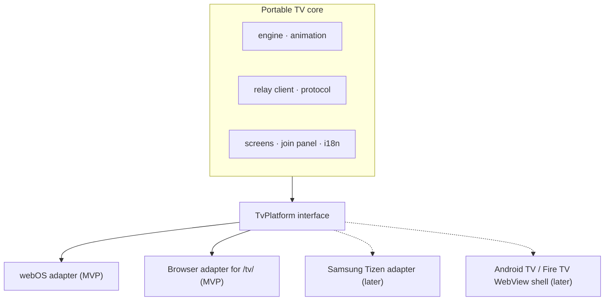

`TvPlatform` covers remote keys, Back and exit, keeping the screen awake, the app lifecycle, persistent storage and device information.

| A new platform needs                                     | Where                                                                                              |
| -------------------------------------------------------- | -------------------------------------------------------------------------------------------------- |
| Key codes, Back and exit, keep-awake strategy, lifecycle | A new adapter in `tv/src/platform/`                                                                |
| Packaging, signing and installation                      | A new build target and scripts, for example a `.wgt` for Tizen or an `.apk` wrapper for Android TV |
| Backend, protocol, engine, extraction, PWA               | No change                                                                                          |

Smart TVs newer than this one generally ship web engines newer than Chromium 53, so the same bundle is expected to run on them; each platform still needs a test on a real device. Keeping the screen awake differs per platform (a full-screen video on webOS, a native API elsewhere, the Screen Wake Lock API in browsers), which is why it belongs to the adapter. Publishing in TV app stores remains out of scope.

## 14. Repository layout and operations

### 14.1 Workspaces

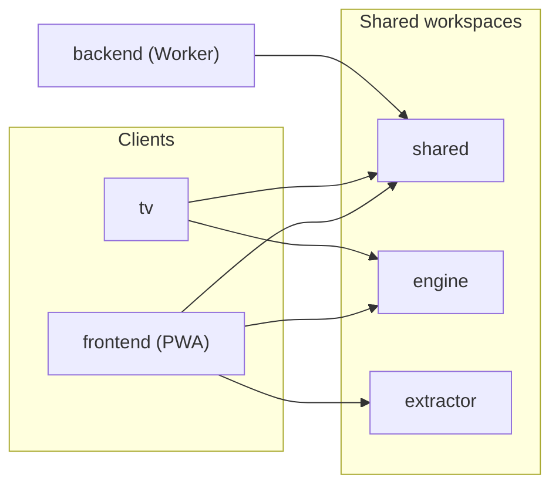

### 14.2 Folder tree (planned)

```text
bwinkeler-aquarium/
├── AGENTS.md                    rules for AI-assisted work (platform template)
├── README.md
├── package.json                 npm workspaces + "validate"
├── .node-version                22.14.0
├── .gitattributes · .editorconfig · .prettierrc · eslint.config.js
├── docs/
│   ├── PLATFORM_ARCHITECTURE.md copy of BW-PLATFORM-ARCH-001 v1.3
│   ├── REQUIREMENTS.md          BW-AQUARIUM-REQ-001
│   ├── SERVICE_MANIFEST.md      platform §26 sections, with the exceptions
│   ├── OPERATIONS.md            release, rollback, TV install, Developer Mode
│   ├── DESIGN.md                this document
│   └── ADR/                     001–005
├── shared/                      Zod schemas (API, WebSocket), TV guards, limits, i18n helper
├── engine/                      world, behaviors, WebGL/Canvas renderers (Chromium 53 safe)
├── extractor/                   image ops, detectors, pipeline, fixtures
├── backend/                     Worker, AquariumDO, JoinCodeDO, RegistryDO, wrangler.jsonc, tests
├── frontend/                    React PWA (built into dist/join/), site/ (_headers, _redirects), public/templates/
├── tv/                          webOS app: appinfo.json, assets/, src/platform/, ares scripts
├── spikes/tv-spike/             Phase 0 webOS app (ES5, no build step)
├── scripts/                     generate-spike-icons.mjs, check-artifacts.mjs, generate-templates.mjs
└── .github/workflows/           ci.yaml, deploy.yaml, webos-devmode-renew.yaml
```

### 14.3 Deployment and operations

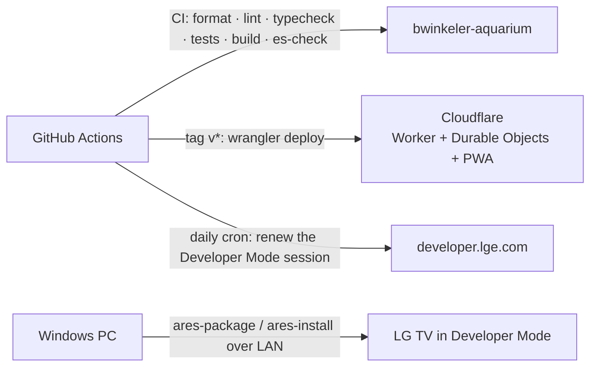

- **Release:** the same flow as Listly: `npm version` in a `chore(release)` commit and a `vX.Y.Z` tag; `deploy.yaml` runs `wrangler deploy` in the `production` environment with `CLOUDFLARE_ACCOUNT_ID` and `CLOUDFLARE_API_TOKEN`. Roll back with `wrangler rollback` to the previous version.
- **Cloudflare:** one deploy publishes the Worker, the three Durable Object classes, the static assets (aquarium screen at `/` and `/tv/`, phone PWA at `/join/`) and the Custom Domain.
- **TV:** `tv:package` (`ares-package`), `tv:install` (`ares-install`), `tv:launch` and `tv:inspect` (remote DevTools); CI attaches the IPK to each release.
- **Developer Mode renewal:** a scheduled workflow calls the renewal endpoint with the session token stored as a repository secret.
- **Line endings:** `.gitattributes` with `* text=auto eol=lf`; shell scripts and workflows break with CRLF.

### 14.4 Changes outside this repository

In `bwinkeler-infra`, as a separate commit (platform §1.2):

1. Add the `aquarium` folder to `bwinkeler.code-workspace`.
2. Register the repository in `scripts/repos.json` and `docs/REPOSITORIES.md`.
3. In `docs/inventory.md`: a "Cloudflare Workers applications" table, the DNS row for `aquarium.bwinkeler.com` (Worker Custom Domain), and a note that aquarium data is short-lived and not backed up.
4. Archive the original prompt, untranslated, as `docs/archive/prompts/aquarium.md` and add it to that folder's table.
5. Close the open browser-cache item (Browser Cache TTL = Respect Existing Headers) if `sw.js` on `aquarium.bwinkeler.com` also comes back with a 4-hour cache.

In the Cloudflare account, by hand:

6. Create the private R2 bucket `bwinkeler-aquarium-files`.
7. Create a deploy API token limited to the account and the `bwinkeler.com` zone (Worker scripts and Custom Domains), and store `CLOUDFLARE_ACCOUNT_ID` and `CLOUDFLARE_API_TOKEN` in the repository's `production` environment.

Nothing changes on the VPS, in Caddy, in PostgreSQL or in GHCR.

## 15. Implementation plan

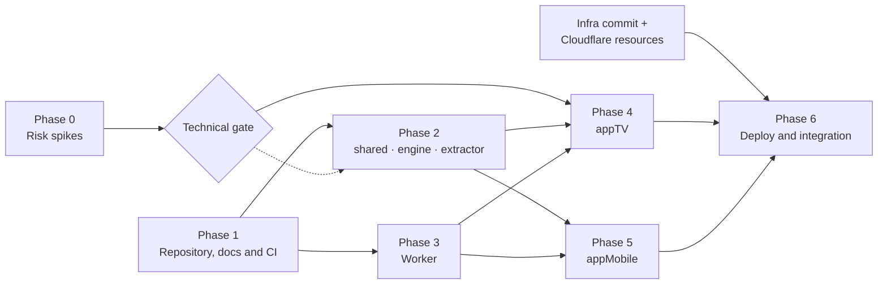

### Phase 0 — Risk spikes

Run in parallel; the results set the technical choices. Every TV spike is a small throwaway webOS app installed in Developer Mode; nothing depends on the TV's own web browser.

1. **TV graphics:** a minimal app with a full-screen looping video and a transparent WebGL canvas with 20 deforming sprites and an FPS counter. Measure FPS at 1920×1080 and 1280×720 (`resolution`), check the loop seam, and leave the TV 2 hours without remote input to confirm the screensaver stays away. Decides: WebGL or Canvas 2D, render resolution, video or procedural backdrop.
2. **Connectivity:** deploy a "hello" Worker on `aquarium.bwinkeler.com` with `/health/live` and an echo WebSocket, and call both from the spike app (XHR from `file://` with CORS, then WSS). Confirms the certificate chain, CORS and WebSockets on Chromium 53.
3. **Extraction:** prototype the pipeline on 15–20 real photos (pencil, marker, crayon, colored and outline-only, shadows, the printed template). These photos become test fixtures.
4. **PWA on phones:** camera and gallery on iOS and Android (HEIC photos, 12 MP+ images, inline muted video, home-screen storage and cookies).

### Phase 1 — Repository, docs and CI

Can start alongside Phase 0.

5. Create `brunowinkeler/bwinkeler-aquarium`; copy `.gitattributes`, `.editorconfig`, `.prettierrc`, the ESLint flat config, `.node-version` and the root `package.json` pattern (npm workspaces, `validate`) from Listly.
6. Docs from [14.2](#142-folder-tree-planned): copy `PLATFORM_ARCHITECTURE.md` v1.3; write `REQUIREMENTS.md`, `SERVICE_MANIFEST.md` (platform §26 sections, with the exceptions), ADRs 001–005 and `AGENTS.md` (the Listly template plus: the TV bundle must run on Chromium 53; nothing secret in the PWA or TV bundles); move this document to `docs/DESIGN.md`.
7. `ci.yaml` (actions v7): format, lint, typecheck, tests, build, `es-check es6` on the TV bundle, artifact budget, Worker tests, and Playwright e2e with axe.
8. Infra commit and Cloudflare resources from [14.4](#144-changes-outside-this-repository). _Parallel with steps 5–7._

### Phase 2 — Shared workspaces

After step 5; parallel; step 10 also depends on spike 1.

9. `shared`: Zod 4.5+ schemas for the HTTP API and WebSocket messages (used by the backend and the PWA), small hand-written guards for the TV (no Zod on Chromium 53), `CreatureKind`, `Facing`, limits (`MAX_ACTIVE = 20`, `EXPORT_DIM = 512`, `MAX_IMAGE_DIM = 1024`, `MAX_IMAGE_BYTES`, `RECONNECT_WINDOW_HOURS = 4`) and the `t()` helper.
10. `engine`:
    - `World` and the four behaviors.
    - State machine and seeded personality.
    - WebGL 1 renderer with a Canvas 2D fallback.
    - Fixed time step, adaptive quality, preview mode.
11. `extractor`:
    - Image operations: color conversion, blur, dilate/erode, flood fill, connected components, homography, bilinear warp, Otsu.
    - `detectPaperQuad` for free sheets and `detectTemplate` (own marker reader, see 9.4) for templates.
    - `extractCreature(params)`, running in a Web Worker, with golden tests on the fixtures.

### Phase 3 — Worker

After step 9; parallel with steps 10–11.

12. `wrangler.jsonc`: Custom Domain, static assets (SPA fallback; Worker first for `/api/*`, `/ws/*` and `/health/*`), SQLite Durable Objects `AquariumDO`, `JoinCodeDO` and `RegistryDO`, R2 binding `IMAGES`, rate-limit bindings, observability.
13. Routes from [12.1](#121-http-and-websocket-api) and the health checks.
14. `AquariumDO`: embedded migrations, `revision`, capacity of 20, hibernating fan-out, per-message authorization, `Waiting` deadline and expiry alarm.
15. `JoinCodeDO` (one per code, with its TTL) and `RegistryDO` (live aquariums, creation quotas, daily orphan sweep).
16. Security and limits from [12.5](#125-security-and-abuse-limits).
17. Tests with `@cloudflare/vitest-plugin`, including expiry with simulated time.

### Phase 4 — appTV

After spikes 1–2, steps 9–10 and 12–16.

18. Build targeting `chrome53`, `appinfo.json`, and the `TvPlatform` interface with the webOS and browser adapters.
19. Screens: home ("New aquarium"), join panel (QR + code, refreshed before it expires), corner chip (OK = show code, phone count), Back menu (show code, disconnect phones, end aquarium, exit) and an "aquarium ended" screen.
20. Resume on launch within the reconnection window; clear the saved credentials on `410`.
21. The three render layers; pause while hidden.
22. `RelayClient` with first-message auth, reconnection, ping, resync, revision-gap detection, polling fallback and offline indicator.
23. Creature lifecycle: download → texture; entry dive with bubbles; exit swimming off-screen; neighbors get startled; toasts for new creatures and joined phones.
24. CC0 demo fish while the aquarium is empty; IndexedDB cache cleared when the aquarium ends.
25. Scripts `tv:package`, `tv:install`, `tv:launch`, `tv:inspect` and the Developer Mode renewal workflow.

### Phase 5 — appMobile

After steps 9–17; parallel with Phase 4.

26. App shell: React 19, react-router 7, `vite-plugin-pwa` with prompted updates, `pt-BR` and `en` catalogues, `site/_headers`.
27. Join by code or QR scan (`getUserMedia` + jsQR); `/join/?code=` link; leave; "aquarium ended" handling on `410`.
28. Capture from camera or gallery; downscale to at most 2048 px.
29. Corner adjustment with four draggable handles and a magnifier; skipped when markers are found.
30. Preview with the engine in preview mode over the same background video, with all controls.
31. Send: ULID generated on the phone, retry on failure, TV online status, "shown on the TV" confirmation through `displayedAt`.
32. "This aquarium": creature list with remove.
33. Printable templates (SVG and A4 PDF): one generic plus one per kind.

### Phase 6 — Deploy and integration

After Phases 4 and 5.

34. `deploy.yaml`; first release; install the TV app; smoke test (health, create, join, send, WebSocket, and expiry with a shortened window).
35. End-to-end Playwright test: PWA with fixtures → `wrangler dev` → `/tv/` in Chromium.
36. 8-hour run on the TV.
37. Visual polish: bubbles, caustics (if performance allows), soft shadow near the sand.
38. Set the inventory status to `active` in `bwinkeler-infra`; complete `OPERATIONS.md` (release, rollback, TV install, Developer Mode) and a short user guide (install the PWA, print templates).

## 16. Verification

1. **Vitest:** extracted masks reach IoU ≥ 0.95 against hand-labeled masks; homography and flood-fill unit tests; behaviors are deterministic for a given seed.
2. **Worker tests:**
   - Create and resume an aquarium; creation quotas and the live-aquarium cap.
   - Join codes expire after 10 minutes, work for several phones, and join attempts are rate limited per IP.
   - Upload rejections: 415 for non-PNG, 413 over 1.5 MB, 422 over 1024 px.
   - Capacity with the emitted event.
   - The WebSocket closes without `auth` within 5 s, and after a revocation.
   - `Waiting` turns into expiry after 4 h: storage and R2 objects are deleted and later requests get `410`; the TV reconnecting in time cancels the expiry.
   - CORS only on `/api/tv/*`; cross-site requests are rejected.
3. **TV bundle:** `es-check` passes; the app installs and runs on the real TV through `ares-install`.
4. **On the TV:** at least 50 FPS with 20 creatures; no screensaver after 2 hours idle; stable memory over 8 hours.
5. **Network loss:** unplug the router for 5 minutes; cached creatures keep swimming, and the TV reconnects and resyncs on its own.
6. **Sessions end to end:** create an aquarium, join from two phones, show the code again, disconnect the phones and end the aquarium; then switch the TV off for longer than a shortened window and confirm that both apps return to their start screens.
7. **On iOS and Android:** join, take a photo, use the gallery, preview and send; from send to visible on the TV in under 3 seconds.
8. **Fidelity:** the PNG checksum logged by the phone matches the one logged by the TV.
9. **Operations:** `/health/ready` returns 200 in production; one `wrangler rollback` drill; Workers Logs contain no tokens, cookies or join codes; `sw.js` is served with `no-cache`.

## 17. Scope and rejected alternatives

**Out of scope:** store publishing (LG Content Store, App Store, Play Store), adapters for other TV brands (ready to add, see [13](#13-scaling-to-more-tvs-and-brands)), several TVs in one aquarium, accounts and login, permanent aquariums and backups, AI segmentation, and sound (see [open questions](#18-open-questions)).

| Alternative                                                   | Why not                                                                                                                                                 |
| ------------------------------------------------------------- | ------------------------------------------------------------------------------------------------------------------------------------------------------- |
| Platform VPS backend (Fastify + PostgreSQL + R2, like Listly) | The platform default, set aside in ADR 001: short-lived real-time rooms fit Durable Objects, need no backups, and keep this product off the shared host |
| Aquariums created only by an admin script                     | Safer by default, but needs SSH and a code typed on the TV; anonymous creation with limits gives the intended TV-first flow                             |
| Permanent aquariums with backups                              | Not wanted: an aquarium is a session, and expiry keeps storage and privacy exposure small                                                               |
| Direct phone → TV connection on the LAN                       | The TV web app cannot accept connections, and LG Connect SDK is unmaintained                                                                            |
| AI background removal                                         | Photo-trained models mistake the whole sheet for the subject; heavy downloads                                                                           |
| PixiJS v8                                                     | Designed for WebGL 2 (WebGL 1 is a legacy fallback) and modern JavaScript; risky on Chromium 53                                                         |
| Firebase                                                      | Modern, heavy SDK for Chromium 53                                                                                                                       |
| Hosted web app on the TV                                      | Downloads everything at each launch (the cache does not persist) and depends on the network                                                             |
| Capacitor or React Native                                     | Need a Mac or cloud macOS for iOS builds; little extra value over a PWA here                                                                            |

## 18. Open questions

1. **Background video source.** Recommended: render our own loop from Kenney Fish Pack (CC0) art, for a consistent style and clear licensing. Alternatives: licensed stock footage without fish, or a procedural backdrop with a hidden keep-alive video.
2. **Abuse-limit defaults** in [12.5](#125-security-and-abuse-limits): review them after the first weeks of use.
3. **Ambient sound on the TV.** Bubbles and music with a mute key, for a later version.

## 19. References

Platform

- `bwinkeler-infra/ARCHITECTURE.md` (`BW-PLATFORM-ARCH-001` v1.3, private repository)

LG webOS TV

- [Web API and Web Engine][lg-engine]
- [Web App Types][lg-app-types]
- [appinfo.json][lg-appinfo]
- [Screensaver][lg-screensaver]
- [FAQ: playing video in full screen][lg-fullscreen-video]
- [App Testing with Developer Mode App][lg-devmode]
- [TV Device Information][lg-systeminfo]

webOS homebrew community

- [dev-manager-desktop (Developer Mode renewal script)][webosbrew-dev-manager]
- [dev-utils (`devmode-reset.sh`)][webosbrew-dev-utils]
- [dev-toolbox-cli (firmware symbol dumps)][webosbrew-toolbox]

Cloudflare

- [Durable Objects limits][cf-do-limits]
- [Durable Objects WebSockets][cf-do-websockets]
- [Rate Limiting binding][cf-rate-limit]
- [Certificate authorities][cf-cas]
- [Workers limits][cf-workers-limits]
- [Static assets configuration][cf-assets]
- [Custom Domains][cf-custom-domains]

Libraries and assets

- [Kenney Fish Pack][kenney-fish]
- [js-aruco2][js-aruco2]
- [PixiJS][pixijs]

[lg-engine]: https://webostv.developer.lge.com/develop/specifications/web-api-and-web-engine
[lg-app-types]: https://webostv.developer.lge.com/develop/getting-started/web-app-types
[lg-appinfo]: https://webostv.developer.lge.com/develop/references/appinfo-json
[lg-screensaver]: https://webostv.developer.lge.com/develop/guides/screensaver
[lg-fullscreen-video]: https://webostv.developer.lge.com/faq/how-can-i-set-my-app-to-play-video-in-full-screen
[lg-devmode]: https://webostv.developer.lge.com/develop/getting-started/developer-mode-app
[lg-systeminfo]: https://webostv.developer.lge.com/develop/references/tv-device-information
[webosbrew-dev-manager]: https://github.com/webosbrew/dev-manager-desktop
[webosbrew-dev-utils]: https://github.com/webosbrew/dev-utils
[webosbrew-toolbox]: https://github.com/webosbrew/dev-toolbox-cli
[cf-do-limits]: https://developers.cloudflare.com/durable-objects/platform/limits/
[cf-do-websockets]: https://developers.cloudflare.com/durable-objects/best-practices/websockets/
[cf-rate-limit]: https://developers.cloudflare.com/workers/runtime-apis/bindings/rate-limit/
[cf-cas]: https://developers.cloudflare.com/ssl/reference/certificate-authorities/
[cf-workers-limits]: https://developers.cloudflare.com/workers/platform/limits/
[cf-assets]: https://developers.cloudflare.com/workers/static-assets/binding/
[cf-custom-domains]: https://developers.cloudflare.com/workers/configuration/routing/custom-domains/
[kenney-fish]: https://kenney.nl/assets/fish-pack
[js-aruco2]: https://github.com/damianofalcioni/js-aruco2
[pixijs]: https://github.com/pixijs/pixijs
